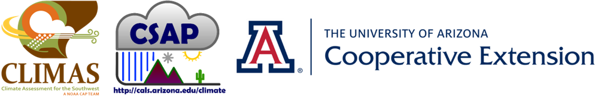

::: {.dashboard-heading}
::: {.dashboard-heading-title}
# Current Conditions

:::

::: {.dashboard-status}
**Site updated:** [Recorded at render time]{.dashboard-rendered-at}

**PRISM through:** October 05, 2026
:::
:::

::: {.archive-year-intro .dashboard-roni .archive-roni-el-nino}
[Strong El Niño-range conditions · RONI +1.7 °C]{.archive-roni-badge}

**JAS · Jul 2026–Sep 2026** — latest published three-month period.

**NOAA status:** El Niño Advisory · issued Oct 08, 2026. [CPC discussion](https://www.cpc.ncep.noaa.gov/products/analysis_monitoring/enso_advisory/ensodisc.shtml)

Recent values are provisional; one period does not establish an ENSO episode. [NOAA CPC](https://www.cpc.ncep.noaa.gov/products/analysis_monitoring/enso/roni/)
:::

::: {.dashboard-headlines}
::: {.dashboard-headline .headline-wet .headline-strong}
### [Recent precipitation](pages/products/pcpn_percentile_07day.qmd){.headline-link}

[Past 7 days]{.headline-period}

<strong>0%</strong><small>below normal</small><strong>100%</strong><small>above normal</small>

[AZ + NM · Through Oct 05, 2026]{.headline-date}
:::

::: {.dashboard-headline .headline-wet}
### [Seasonal Precipitation](pages/products/pcpn_percentile_90day.qmd){.headline-link}

[Past 90 days]{.headline-period}

<strong>3%</strong><small>below normal</small><strong>65%</strong><small>above normal</small>

[AZ + NM · Through Oct 05, 2026]{.headline-date}
:::

::: {.dashboard-headline .headline-warm}
### [Recent temperature](pages/products/tmean_departure_30day.qmd){.headline-link}

[Past 30 days]{.headline-period}

<strong>+2.4°F</strong><small>from normal</small>

[AZ + NM · Through Oct 05, 2026]{.headline-date}
:::

:::

::: {.dashboard-map-grid}
::: {.dashboard-row-heading}
## Recent rainfall
:::

::: {.dashboard-map-card}
::: {.dashboard-map-summary}
Past 7 days 1.52″ avg ≥0.10″: 100%
:::

[{fig-alt="Map showing 7-day total across Arizona and New Mexico"}](pages/products/pcpn_total_07day.qmd)

::: {.dashboard-card-actions}
[View details](pages/products/pcpn_total_07day.qmd){.btn .btn-sm .btn-outline-primary}
[Full-resolution PNG](maps/generated/prism/precipitation/pcpn-total-07day-latest.png){.dashboard-full-resolution}
:::
:::

::: {.dashboard-map-card}
::: {.dashboard-map-summary}
Past 30 days Very dry: 0% Very wet: 68%
:::

[{fig-alt="Map showing 30-day percentile rank across Arizona and New Mexico"}](pages/products/pcpn_percentile_30day.qmd)

::: {.dashboard-card-actions}
[View details](pages/products/pcpn_percentile_30day.qmd){.btn .btn-sm .btn-outline-primary}
[Full-resolution PNG](maps/generated/prism/precipitation/pcpn-percentile-rank-30day-latest.png){.dashboard-full-resolution}
:::
:::

::: {.dashboard-row-heading}
## Seasonal context
:::

::: {.dashboard-map-card}
::: {.dashboard-map-summary}
Past 90 days Very dry: 0% Very wet: 19%
:::

[{fig-alt="Map showing 90-day percentile rank across Arizona and New Mexico" loading="lazy"}](pages/products/pcpn_percentile_90day.qmd)

::: {.dashboard-card-actions}
[View details](pages/products/pcpn_percentile_90day.qmd){.btn .btn-sm .btn-outline-primary}
[Full-resolution PNG](maps/generated/prism/precipitation/pcpn-percentile-rank-90day-latest.png){.dashboard-full-resolution}
:::
:::

::: {.dashboard-map-card}
::: {.dashboard-map-summary}
Water year to date Very dry: 0% Very wet: 5%
:::

[{fig-alt="Map showing percentile rank across Arizona and New Mexico" loading="lazy"}](pages/products/pcpn_water_year_percentile.qmd)

::: {.dashboard-card-actions}
[View details](pages/products/pcpn_water_year_percentile.qmd){.btn .btn-sm .btn-outline-primary}
[Full-resolution PNG](maps/generated/prism/precipitation/pcpn-water-year-percentile-rank-latest.png){.dashboard-full-resolution}
:::
:::

::: {.dashboard-row-heading}
## Temperature and dry spells
:::

::: {.dashboard-map-card}
::: {.dashboard-map-summary}
Past 30 days +2.4°F from normal
:::

[{fig-alt="Map showing mean temperature departure across Arizona and New Mexico" loading="lazy"}](pages/products/tmean_departure_30day.qmd)

::: {.dashboard-card-actions}
[View details](pages/products/tmean_departure_30day.qmd){.btn .btn-sm .btn-outline-primary}
[Full-resolution PNG](maps/generated/prism/temperature/tmean-departure-30day-latest.png){.dashboard-full-resolution}
:::
:::

::: {.dashboard-map-card}
::: {.dashboard-map-summary}
Ongoing dry spell Long dry spells: 0%
:::

[{fig-alt="Map showing current dry-spell percentile across Arizona and New Mexico" loading="lazy"}](pages/products/pcpn_current_dry_spell_percentile.qmd)

::: {.dashboard-card-actions}
[View details](pages/products/pcpn_current_dry_spell_percentile.qmd){.btn .btn-sm .btn-outline-primary}
[Full-resolution PNG](maps/generated/prism/precipitation/pcpn-current-dry-spell-percentile-rank-latest.png){.dashboard-full-resolution}
:::
:::

:::

::: {.dashboard-note}
PRISM percentile ranks compare matching periods in 1991–2020. Low precipitation ranks indicate drier conditions. Temperature departure is in °F; positive values mean warmer conditions. A high dry-spell rank means an unusually long ongoing dry spell. These indicators describe conditions, not a combined drought classification.

Water-year precipitation starts October 1. Early-season ranks describe a short period; use the 90-day map for broader context.

Map summaries describe combined Arizona and New Mexico, weighted by grid-cell area within state boundaries. At least 98% valid area is required. Percentile summaries show area below or above the stated thresholds; they do not average pixel percentiles. Rainfall coverage uses the stated accumulation threshold. Each summary follows its map's period and data date.

Very dry/wet: percentage of AZ/NM area below the 10th/above the 90th precipitation percentile by default. Long dry spells uses the high tail. Stronger chip colors indicate a larger affected area, not greater severity; gray indicates a smaller footprint. Temperature colors indicate cooler/warmer departures, not a significance test. Hover over a value for its configured threshold and date. Rainfall amounts remain neutral because amount alone does not establish rarity.

Headline precipitation cards show area below the 33rd/above the 67th percentile by default. Brown/teal indicates widespread below-/above-normal conditions; mixed shading retains both signals. These display cues are not regional percentile ranks or drought classifications. Headline temperature is an area-weighted departure from 1991–2020 normal.
:::

::: {#historic-seasons .dashboard-history-links}
## Compare historic seasons
Browse completed water years:
[WY2025](pages/archive/wy2025.qmd) · [WY2024](pages/archive/wy2024.qmd) · [WY2023](pages/archive/wy2023.qmd) · [WY2022](pages/archive/wy2022.qmd) · [WY2021](pages/archive/wy2021.qmd)

Additional completed years are listed under Historic Years in the navigation menu.
:::

::: {.dashboard-explore-more}
**Explore more:** [Daily Explorer](pages/daily-explorer.qmd) · [Station Conditions](pages/station-conditions.qmd) · [Current Snow](pages/current-snow.qmd) · [Historic Seasons](#historic-seasons)
:::

::: {.institutional-branding .dashboard-branding}
{fig-alt="Logos for CLIMAS, the Climate Science Applications Program, and University of Arizona Cooperative Extension"}

::: {.dashboard-branding-links}
[Climate Assessment for the Southwest](https://www.climas.arizona.edu/) · [Climate Science Applications Program](https://cales.arizona.edu/climate/) · [University of Arizona Cooperative Extension](https://extension.arizona.edu/topics/climate)
:::

::: {.dashboard-contact}
Mike Crimmins · [crimmins@arizona.edu](mailto:crimmins@arizona.edu)
:::
:::
